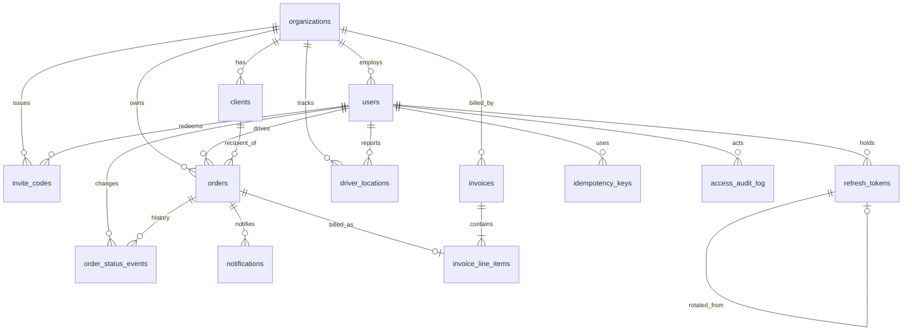

# Database Schema Reference

PostgreSQL schema for the Drugstore Delivery B2B server, as of migration `013_driver_notifications`.

**Source of truth:** the SQL files in `database/migrations/`. This document is a human-readable snapshot of the applied result (base schema `drugstore_delivery_schema.sql` plus migrations `001`–`013`). The migrator also creates `schema_migrations`.

**Scope:** logistics only. No medical, pharmaceutical, or prescription data is modeled.

Required extension: `pgcrypto` (`gen_random_uuid()`).

---

## Entity relationship overview

---

## Enum types

| Type | Values | Notes |
| --- | --- | --- |
| `user_role` | `admin`, `driver` | Unified login. Exactly one admin per organization (partial unique index). |
| `delivery_window` | `AM`, `PM` | Clock bounds live on `organizations`, not on the enum. |
| `order_status` | `scheduled`, `in_pharmacy`, `picked_up`, `completed`, `returned`, `returned_to_pharmacy`, `cancelled` | Terminal: `completed`, `returned_to_pharmacy`, `cancelled`. `scheduled` is the admin calendar — invisible to drivers. `returned` is **not** terminal: the package is in the driver's van until the handover. A second delivery attempt is a **new** order. See `docs/delivery-workflow.md`. |
| `payment_status` | `paid`, `unpaid` | Patient-at-the-door payment, not pharmacy invoicing. |
| `payment_method` | `cash`, `card` | Set by the driver at drop-off. No card PAN is stored. |
| `notification_channel` | `sms`, `email` | Twilio-powered. |
| `notification_status` | `queued`, `sent`, `failed` | |
| `invoice_status` | `draft`, `issued`, `paid`, `void` | Bills the **pharmacy** for delivery services. |
| `delivery_failure_reason` | `customer_absent`, `customer_refused`, `wrong_address`, `payment_refused`, `other` | Why a delivery attempt failed. Required on `returned`. |
| `payment_exception` | `waived_by_pharmacy`, `deferred_to_pharmacy` | Delivered without collecting, after the driver called the pharmacy. |
| `package_type` | `bag`, `cooler`, `tote`, `envelope` | Closed set, deliberately. There is no free-text package description anywhere. |
| `driver_notification_type` | `order_assigned`, `order_ready`, `order_unassigned`, `order_cancelled` | In-app driver feed. |

---

## Tables

### `schema_migrations`

Created by the migrator (`src/db/migrator.ts`), not by a `.sql` file.

| Column | Type | Null | Default | Notes |
| --- | --- | --- | --- | --- |
| `name` | `VARCHAR(255)` | NO | | Primary key. File basename without `.sql`, or `000_base_schema`. |
| `checksum` | `CHAR(64)` | NO | | SHA-256 of the SQL file. |
| `baselined` | `BOOLEAN` | NO | `FALSE` | `TRUE` when recorded as already-satisfied rather than executed. |
| `applied_at` | `TIMESTAMPTZ` | NO | `now()` | |

---

### `organizations`

Drugstores / pharmacies — the B2B tenants.

| Column | Type | Null | Default | Notes |
| --- | --- | --- | --- | --- |
| `id` | `UUID` | NO | `gen_random_uuid()` | PK |
| `name` | `VARCHAR(255)` | NO | | |
| `address` | `VARCHAR(500)` | YES | | |
| `phone` | `VARCHAR(50)` | YES | | |
| `email` | `VARCHAR(255)` | YES | | |
| `is_active` | `BOOLEAN` | NO | `TRUE` | |
| `delivery_rate` | `NUMERIC(10, 2)` | NO | `0` | Current flat per-delivery rate. Historical invoices snapshot the rate on each line item. |
| `timezone` | `VARCHAR(64)` | NO | `'America/Toronto'` | AM/PM window times are local to this zone. |
| `locale` | `CHAR(2)` | NO | `'fr'` | `fr` or `en`. |
| `am_window_start` | `TIME` | NO | `'09:00'` | |
| `am_window_end` | `TIME` | NO | `'12:00'` | |
| `pm_window_start` | `TIME` | NO | `'13:00'` | |
| `pm_window_end` | `TIME` | NO | `'17:00'` | |
| `return_deadline` | `TIME` | NO | `'18:00'` | When the driver must be back at the pharmacy with cash, invoices, and returns. |
| `created_at` | `TIMESTAMPTZ` | NO | `now()` | |
| `updated_at` | `TIMESTAMPTZ` | NO | `now()` | Maintained by `trg_organizations_updated_at`. |

**Constraints**

- `chk_delivery_rate_non_negative` — `delivery_rate >= 0`
- `chk_org_locale` — `locale IN ('fr', 'en')`

**Triggers:** `trg_organizations_updated_at` (`BEFORE UPDATE` → `set_updated_at()`)

---

### `clients`

Patients saved against an organization so staff can pick from a list instead of re-typing logistics fields.

| Column | Type | Null | Default | Notes |
| --- | --- | --- | --- | --- |
| `id` | `UUID` | NO | `gen_random_uuid()` | PK |
| `organization_id` | `UUID` | NO | | FK → `organizations(id)` `ON DELETE CASCADE` |
| `name` | `VARCHAR(255)` | NO | | PII |
| `address` | `VARCHAR(500)` | NO | | PII |
| `phone_number` | `VARCHAR(50)` | NO | | PII |
| `notes` | `VARCHAR(500)` | YES | | Logistics notes only. |
| `is_active` | `BOOLEAN` | NO | `TRUE` | |
| `created_at` | `TIMESTAMPTZ` | NO | `now()` | |
| `updated_at` | `TIMESTAMPTZ` | NO | `now()` | Maintained by `trg_clients_updated_at`. |

**Indexes**

| Name | Columns |
| --- | --- |
| `idx_clients_organization` | `(organization_id)` |
| `idx_clients_name` | `(organization_id, name)` |

**Triggers:** `trg_clients_updated_at`

---

### `invite_codes`

Org keys used to link a driver to an organization.

| Column | Type | Null | Default | Notes |
| --- | --- | --- | --- | --- |
| `id` | `UUID` | NO | `gen_random_uuid()` | PK |
| `organization_id` | `UUID` | NO | | FK → `organizations(id)` `ON DELETE CASCADE` |
| `code` | `VARCHAR(32)` | NO | | Unique. |
| `is_active` | `BOOLEAN` | NO | `TRUE` | |
| `expires_at` | `TIMESTAMPTZ` | YES | | |
| `redeemed_by_user_id` | `UUID` | YES | | FK → `users(id)` `ON DELETE SET NULL` |
| `redeemed_at` | `TIMESTAMPTZ` | YES | | |
| `created_at` | `TIMESTAMPTZ` | NO | `now()` | |

**Indexes**

| Name | Columns |
| --- | --- |
| `idx_invite_codes_org` | `(organization_id)` |
| *(unnamed unique)* | `(code)` |

---

### `users`

Unified login — admin or driver.

| Column | Type | Null | Default | Notes |
| --- | --- | --- | --- | --- |
| `id` | `UUID` | NO | `gen_random_uuid()` | PK |
| `organization_id` | `UUID` | YES | | FK → `organizations(id)` `ON DELETE SET NULL`. Required for admins. |
| `role` | `user_role` | NO | | |
| `email` | `VARCHAR(255)` | NO | | Unique. |
| `password_hash` | `VARCHAR(255)` | NO | | |
| `phone` | `VARCHAR(50)` | YES | | PII |
| `first_name` | `VARCHAR(100)` | NO | | |
| `last_name` | `VARCHAR(100)` | NO | | |
| `is_active` | `BOOLEAN` | NO | `TRUE` | |
| `created_at` | `TIMESTAMPTZ` | NO | `now()` | |
| `updated_at` | `TIMESTAMPTZ` | NO | `now()` | Maintained by `trg_users_updated_at`. |

**Constraints**

- `chk_admin_has_organization` — `role <> 'admin' OR organization_id IS NOT NULL`

**Indexes**

| Name | Columns | Notes |
| --- | --- | --- |
| `idx_users_organization` | `(organization_id)` | |
| `idx_users_role` | `(role)` | |
| `idx_one_admin_per_organization` | `(organization_id)` | Unique, `WHERE role = 'admin'`. |
| *(unnamed unique)* | `(email)` | |

**Triggers:** `trg_users_updated_at`

---

### `orders`

One delivery attempt. Logistics data only. Client name/address/phone are snapshotted at creation so later client edits never rewrite history.

| Column | Type | Null | Default | Notes |
| --- | --- | --- | --- | --- |
| `id` | `UUID` | NO | `gen_random_uuid()` | PK |
| `organization_id` | `UUID` | NO | | FK → `organizations(id)` `ON DELETE CASCADE` |
| `driver_id` | `UUID` | YES | | FK → `users(id)` `ON DELETE SET NULL` |
| `client_id` | `UUID` | NO | | FK → `clients(id)` `ON DELETE RESTRICT` |
| `patient_name` | `VARCHAR(255)` | NO | | Snapshot. PII. |
| `address` | `VARCHAR(500)` | NO | | Snapshot. PII. |
| `phone_number` | `VARCHAR(50)` | NO | | Snapshot. PII. |
| `authorized_recipient` | `VARCHAR(255)` | YES | | Who may accept at the door. PII — active driver views only. |
| `delivery_date` | `DATE` | NO | | |
| `delivery_window` | `delivery_window` | NO | | |
| `requested_delivery_time` | `TIME` | YES | | Finer-grained ask than the window, when the pharmacy promised a time. Local to the org timezone. |
| `payment_status` | `payment_status` | NO | `'unpaid'` | What the patient owes at the door. |
| `payment_collected` | `BOOLEAN` | NO | `FALSE` | |
| `payment_collected_at` | `TIMESTAMPTZ` | YES | | |
| `payment_method` | `payment_method` | YES | | Required when `payment_collected` is true. |
| `amount_collected` | `NUMERIC(10, 2)` | YES | | Required when `payment_collected` is true. |
| `amount_due` | `NUMERIC(10, 2)` | YES | | Amount the patient owes. `NULL` = nothing to collect. Unrelated to invoicing. |
| `payment_exception` | `payment_exception` | YES | | Set when a delivery completed without collecting what was owed. Feeds future reconciliation. |
| `payment_exception_note` | `VARCHAR(500)` | YES | | Admin-only free text. |
| `status` | `order_status` | NO | `'scheduled'` | Set by the application on insert; the column default is unchanged, the service always supplies it. |
| `is_priority` | `BOOLEAN` | NO | `FALSE` | Urgent stop. Settable by admin **and** driver — the employee flags it verbally at pickup. |
| `failure_reason` | `delivery_failure_reason` | YES | | Required when `status` is `returned` or `returned_to_pharmacy`. |
| `failure_note` | `VARCHAR(500)` | YES | | Driver free text. May name a person — **admin-only**, redacted from logs. |
| `sequence_number` | `INTEGER` | YES | | Position in the driver's active route. Transient; recalculated when the queue changes. |
| `requires_cooler_bag` | `BOOLEAN` | NO | `FALSE` | |
| `cooler_bag_confirmed` | `BOOLEAN` | YES | | Post-delivery QC check. |
| `pickup_package_count` | `INTEGER` | YES | | What the driver counted while checking labels with the employee. |
| `ready_at` | `TIMESTAMPTZ` | YES | | Required for every status except `scheduled` and `cancelled`. When staff declared the bags packed. |
| `picked_up_at` | `TIMESTAMPTZ` | YES | | |
| `completed_at` | `TIMESTAMPTZ` | YES | | Required when `status = 'completed'`. |
| `returned_at` | `TIMESTAMPTZ` | YES | | Required when `status` is `returned` or `returned_to_pharmacy`. The delivery attempt failed. |
| `returned_to_pharmacy_at` | `TIMESTAMPTZ` | YES | | Required when `status = 'returned_to_pharmacy'`. Staff took the package back. |
| `cancelled_at` | `TIMESTAMPTZ` | YES | | Required when `status = 'cancelled'`. Order never left the pharmacy. Excluded from success-rate. |
| `created_at` | `TIMESTAMPTZ` | NO | `now()` | |
| `updated_at` | `TIMESTAMPTZ` | NO | `now()` | Maintained by `trg_orders_updated_at`. Used by `?updated_since=` polling. |

**Constraints**

- `chk_payment_collected_details` — if `payment_collected` then both `payment_method` and `amount_collected` must be set
- `chk_terminal_status_timestamp` — `completed` / `returned_to_pharmacy` / `cancelled` each require their matching timestamp
- `chk_status_stage_timestamp` — every status except `scheduled` and `cancelled` requires `ready_at`; `returned` and `returned_to_pharmacy` require `returned_at`
- `chk_failure_reason_present` — `returned` and `returned_to_pharmacy` require `failure_reason`
- `chk_amount_due_non_negative` — `amount_due IS NULL OR amount_due >= 0`
- `chk_pickup_package_count_non_negative` — `pickup_package_count IS NULL OR pickup_package_count >= 0`

**Indexes**

| Name | Columns | Notes |
| --- | --- | --- |
| `idx_orders_organization` | `(organization_id)` | |
| `idx_orders_client` | `(client_id)` | |
| `idx_orders_driver` | `(driver_id)` | |
| `idx_orders_status` | `(status)` | |
| `idx_orders_delivery_date` | `(delivery_date)` | |
| `idx_orders_org_date_status` | `(organization_id, delivery_date, status)` | Admin order list. |
| `idx_orders_org_updated` | `(organization_id, updated_at DESC)` | Polling fallback. |
| `idx_orders_driver_date_sequence` | `(driver_id, delivery_date, sequence_number)` | Unique, `WHERE status IN ('in_pharmacy', 'picked_up') AND driver_id IS NOT NULL AND sequence_number IS NOT NULL`. Deliberately unchanged by migration 011: `scheduled` orders are not sequenced, and a `returned` one keeps a stale position that must not collide. |
| `idx_orders_org_date_priority` | `(organization_id, delivery_date, is_priority DESC)` | Partial, active statuses only. Priority stops sort to the front of the driver's queue. |

**Triggers:** `trg_orders_updated_at`

---

### `order_packages`

The physical parcels making up one delivery, so the driver can match printed labels against the app at pickup.

**What this table deliberately does not have:** a description, notes, or quantity of anything nameable. The product constraint is "do not store prescription or medical information", and a free-text line item is exactly where a medication name would end up. `label_code` is what is printed on the bag; `package_type` is a closed enum. The constraint is structural, not a policy someone has to remember.

| Column | Type | Null | Default | Notes |
| --- | --- | --- | --- | --- |
| `id` | `UUID` | NO | `gen_random_uuid()` | PK |
| `order_id` | `UUID` | NO | | FK → `orders(id)` `ON DELETE CASCADE` |
| `label_code` | `VARCHAR(32)` | NO | | Printed on the physical bag, e.g. `4412-A`. Not PII. |
| `package_type` | `package_type` | NO | `'bag'` | A `cooler` package forces `orders.requires_cooler_bag`. |
| `position` | `INTEGER` | NO | | 1-based, contiguous. |
| `created_at` | `TIMESTAMPTZ` | NO | `now()` | |

**Constraints:** `uq_order_packages_position` unique `(order_id, position)`; `chk_order_packages_position` — `position > 0`

**Indexes:** `idx_order_packages_order` on `(order_id)`

---

### `driver_notifications`

In-app feed telling a driver an order was assigned, readied, pulled, or cancelled. Polled by the app; there is **no push provider and no device-token table**.

Separate from `notifications`, which is keyed to `channel ∈ (sms, email)` plus a recipient string and exists for patient messaging.

| Column | Type | Null | Default | Notes |
| --- | --- | --- | --- | --- |
| `id` | `UUID` | NO | `gen_random_uuid()` | PK |
| `organization_id` | `UUID` | NO | | FK → `organizations(id)` `ON DELETE CASCADE` |
| `driver_id` | `UUID` | NO | | FK → `users(id)` `ON DELETE CASCADE` |
| `order_id` | `UUID` | YES | | FK → `orders(id)` `ON DELETE CASCADE` |
| `type` | `driver_notification_type` | NO | | |
| `delivery_date` | `DATE` | YES | | |
| `created_at` | `TIMESTAMPTZ` | NO | `now()` | |
| `read_at` | `TIMESTAMPTZ` | YES | | |

No PII: the order id is a handle the driver resolves through their own queue, which applies the usual scoping.

**Indexes:** `idx_driver_notifications_driver_time` on `(driver_id, created_at DESC)`; `idx_driver_notifications_unread` same columns `WHERE read_at IS NULL`

---

### `order_status_events`

Append-style audit trail of status **changes** (not reads). Feeds admin reports: delivery times, success rates.

| Column | Type | Null | Default | Notes |
| --- | --- | --- | --- | --- |
| `id` | `UUID` | NO | `gen_random_uuid()` | PK |
| `order_id` | `UUID` | NO | | FK → `orders(id)` `ON DELETE CASCADE` |
| `status` | `order_status` | NO | | |
| `changed_by_user_id` | `UUID` | YES | | FK → `users(id)` `ON DELETE SET NULL` |
| `occurred_at` | `TIMESTAMPTZ` | NO | `now()` | |

**Indexes**

| Name | Columns |
| --- | --- |
| `idx_order_status_events_order` | `(order_id)` |
| `idx_order_status_events_occurred` | `(occurred_at DESC)` |
| `idx_order_status_events_status_occurred` | `(status, occurred_at DESC)` |

---

### `driver_locations`

Real-time geolocation log. Powers admin live tracking and Mapbox route optimization.

| Column | Type | Null | Default | Notes |
| --- | --- | --- | --- | --- |
| `id` | `UUID` | NO | `gen_random_uuid()` | PK |
| `driver_id` | `UUID` | NO | | FK → `users(id)` `ON DELETE CASCADE` |
| `organization_id` | `UUID` | YES | | FK → `organizations(id)` `ON DELETE CASCADE`. Denormalized so org-scoped tracking queries skip a join to `users`. |
| `latitude` | `DOUBLE PRECISION` | NO | | |
| `longitude` | `DOUBLE PRECISION` | NO | | |
| `recorded_at` | `TIMESTAMPTZ` | NO | `now()` | |

**Indexes**

| Name | Columns |
| --- | --- |
| `idx_driver_locations_driver_time` | `(driver_id, recorded_at DESC)` |
| `idx_driver_locations_org_time` | `(organization_id, recorded_at DESC)` |

---

### `notifications`

Twilio-powered SMS/email log to the end client.

| Column | Type | Null | Default | Notes |
| --- | --- | --- | --- | --- |
| `id` | `UUID` | NO | `gen_random_uuid()` | PK |
| `order_id` | `UUID` | NO | | FK → `orders(id)` `ON DELETE CASCADE` |
| `channel` | `notification_channel` | NO | | |
| `recipient` | `VARCHAR(255)` | NO | | Phone or email, matching the order at send time. |
| `message` | `VARCHAR(500)` | YES | | |
| `status` | `notification_status` | NO | `'queued'` | |
| `sent_at` | `TIMESTAMPTZ` | YES | | |
| `provider_message_id` | `VARCHAR(128)` | YES | | Twilio SID; used by status callbacks. |
| `error_code` | `VARCHAR(32)` | YES | | Distinguishes retryable vs permanent failure. |
| `error_message` | `VARCHAR(500)` | YES | | |
| `attempt_count` | `INTEGER` | NO | `0` | |
| `last_attempt_at` | `TIMESTAMPTZ` | YES | | |
| `locale` | `CHAR(2)` | NO | `'fr'` | |
| `created_at` | `TIMESTAMPTZ` | NO | `now()` | |

**Indexes**

| Name | Columns | Notes |
| --- | --- | --- |
| `idx_notifications_order` | `(order_id)` | |
| `idx_notifications_provider_message` | `(provider_message_id)` | Partial, `WHERE provider_message_id IS NOT NULL`. |

---

### `refresh_tokens`

Opaque refresh tokens. Stored **only** as a SHA-256 hex hash so a database read is not a usable credential. 30-day TTL, rotated on every use.

| Column | Type | Null | Default | Notes |
| --- | --- | --- | --- | --- |
| `id` | `UUID` | NO | `gen_random_uuid()` | PK |
| `user_id` | `UUID` | NO | | FK → `users(id)` `ON DELETE CASCADE` |
| `token_hash` | `CHAR(64)` | NO | | Unique. SHA-256 hex of the opaque token. |
| `expires_at` | `TIMESTAMPTZ` | NO | | |
| `revoked_at` | `TIMESTAMPTZ` | YES | | |
| `revoked_reason` | `VARCHAR(50)` | YES | | `'rotated'` \| `'logout'` \| `'reuse_detected'` \| `'user_deactivated'` |
| `rotated_from_id` | `UUID` | YES | | FK → `refresh_tokens(id)` `ON DELETE SET NULL`. Replay of a rotated token can revoke the whole family. |
| `family_id` | `UUID` | NO | | Stable across a rotation chain. |
| `user_agent` | `VARCHAR(255)` | YES | | |
| `ip_address` | `INET` | YES | | |
| `created_at` | `TIMESTAMPTZ` | NO | `now()` | |

**Indexes**

| Name | Columns |
| --- | --- |
| `idx_refresh_tokens_user` | `(user_id)` |
| `idx_refresh_tokens_family` | `(family_id)` |
| `idx_refresh_tokens_expires` | `(expires_at)` |
| *(unnamed unique)* | `(token_hash)` |

---

### `invoices`

Bills the **pharmacy** for delivery services rendered. Unrelated to `orders.amount_due` (patient-at-the-door).

| Column | Type | Null | Default | Notes |
| --- | --- | --- | --- | --- |
| `id` | `UUID` | NO | `gen_random_uuid()` | PK |
| `organization_id` | `UUID` | NO | | FK → `organizations(id)` `ON DELETE CASCADE` |
| `invoice_number` | `VARCHAR(32)` | NO | | Unique. |
| `period_start` | `DATE` | NO | | |
| `period_end` | `DATE` | NO | | |
| `status` | `invoice_status` | NO | `'draft'` | |
| `delivery_count` | `INTEGER` | NO | `0` | |
| `subtotal` | `NUMERIC(12, 2)` | NO | `0` | |
| `total` | `NUMERIC(12, 2)` | NO | `0` | |
| `currency` | `CHAR(3)` | NO | `'CAD'` | |
| `issued_at` | `TIMESTAMPTZ` | YES | | |
| `paid_at` | `TIMESTAMPTZ` | YES | | |
| `created_at` | `TIMESTAMPTZ` | NO | `now()` | |
| `updated_at` | `TIMESTAMPTZ` | NO | `now()` | Maintained by `trg_invoices_updated_at`. |

**Constraints**

- `chk_invoice_period` — `period_end >= period_start`

**Indexes**

| Name | Columns | Notes |
| --- | --- | --- |
| `idx_invoices_org_period` | `(organization_id, period_start, period_end)` | Unique. Re-running the monthly job updates the existing draft instead of duplicating it. |
| `idx_invoices_organization` | `(organization_id)` | |
| *(unnamed unique)* | `(invoice_number)` | |

**Triggers:** `trg_invoices_updated_at`

---

### `invoice_line_items`

One row per billable delivery. **Order IDs only** — no patient name, address, or phone.

| Column | Type | Null | Default | Notes |
| --- | --- | --- | --- | --- |
| `id` | `UUID` | NO | `gen_random_uuid()` | PK |
| `invoice_id` | `UUID` | NO | | FK → `invoices(id)` `ON DELETE CASCADE` |
| `order_id` | `UUID` | NO | | FK → `orders(id)` `ON DELETE RESTRICT`. Unique: an order is billed exactly once. |
| `unit_rate` | `NUMERIC(10, 2)` | NO | | Snapshot of `organizations.delivery_rate` at generation time. |
| `quantity` | `INTEGER` | NO | `1` | |
| `amount` | `NUMERIC(12, 2)` | NO | | |
| `delivery_date` | `DATE` | NO | | Logistical context only. |
| `order_status` | `order_status` | NO | | Status at billing time. |
| `created_at` | `TIMESTAMPTZ` | NO | `now()` | |

**Constraints**

- `chk_line_item_quantity` — `quantity > 0`
- `chk_line_item_rate` — `unit_rate >= 0`

**Indexes**

| Name | Columns | Notes |
| --- | --- | --- |
| `idx_invoice_line_items_order` | `(order_id)` | Unique. Voiding an invoice cascades line items away and frees those orders for regeneration. |
| `idx_invoice_line_items_invoice` | `(invoice_id)` | |

---

### `access_audit_log`

Append-only record of PII **reads** (status *changes* go in `order_status_events`). Identity primary key so inserts stay cheap.

| Column | Type | Null | Default | Notes |
| --- | --- | --- | --- | --- |
| `id` | `BIGINT` | NO | `GENERATED ALWAYS AS IDENTITY` | PK |
| `actor_user_id` | `UUID` | YES | | FK → `users(id)` `ON DELETE SET NULL` |
| `actor_role` | `user_role` | YES | | |
| `organization_id` | `UUID` | YES | | Not a FK. |
| `action` | `VARCHAR(64)` | NO | | e.g. `'order.detail.read'`, `'report.export'` |
| `resource_type` | `VARCHAR(64)` | NO | | e.g. `'order'`, `'client'`, `'report'` |
| `resource_ids` | `UUID[]` | YES | | Specific rows, when bounded. |
| `record_count` | `INTEGER` | YES | | Scope size for list/export reads. |
| `ip_address` | `INET` | YES | | |
| `user_agent` | `VARCHAR(255)` | YES | | |
| `request_id` | `VARCHAR(64)` | YES | | |
| `occurred_at` | `TIMESTAMPTZ` | NO | `now()` | |

**Indexes**

| Name | Columns |
| --- | --- |
| `idx_access_audit_actor` | `(actor_user_id, occurred_at DESC)` |
| `idx_access_audit_org` | `(organization_id, occurred_at DESC)` |
| `idx_access_audit_occurred` | `(occurred_at DESC)` |

**Triggers:** `trg_access_audit_log_immutable` (`BEFORE UPDATE OR DELETE` → `reject_audit_log_mutation()`). UPDATE and DELETE raise an exception.

---

### `idempotency_keys`

Replay cache for `Idempotency-Key` on driver mutations. Stored in Postgres (not Redis) so delivery correctness does not depend on a cache surviving.

| Column | Type | Null | Default | Notes |
| --- | --- | --- | --- | --- |
| `id` | `UUID` | NO | `gen_random_uuid()` | PK |
| `user_id` | `UUID` | NO | | FK → `users(id)` `ON DELETE CASCADE` |
| `idempotency_key` | `VARCHAR(255)` | NO | | |
| `request_fingerprint` | `CHAR(64)` | NO | | SHA-256 of method + path + body. Same key, different payload → 409. |
| `response_status` | `INTEGER` | YES | | `NULL` while the first request is in flight; concurrent retries back off. |
| `response_body` | `JSONB` | YES | | Cached response. |
| `completed_at` | `TIMESTAMPTZ` | YES | | |
| `created_at` | `TIMESTAMPTZ` | NO | `now()` | |
| `expires_at` | `TIMESTAMPTZ` | NO | | Expired rows are purged by the retention job. |

**Indexes**

| Name | Columns | Notes |
| --- | --- | --- |
| `idx_idempotency_keys_user_key` | `(user_id, idempotency_key)` | Unique. |
| `idx_idempotency_keys_expires` | `(expires_at)` | |

---

## Functions and triggers

| Function | Language | Purpose |
| --- | --- | --- |
| `set_updated_at()` | plpgsql | Sets `NEW.updated_at = now()` on `UPDATE`. |
| `reject_audit_log_mutation()` | plpgsql | Raises: `access_audit_log is append-only`. |

| Trigger | Table | Event | Function |
| --- | --- | --- | --- |
| `trg_organizations_updated_at` | `organizations` | `BEFORE UPDATE` | `set_updated_at()` |
| `trg_clients_updated_at` | `clients` | `BEFORE UPDATE` | `set_updated_at()` |
| `trg_users_updated_at` | `users` | `BEFORE UPDATE` | `set_updated_at()` |
| `trg_orders_updated_at` | `orders` | `BEFORE UPDATE` | `set_updated_at()` |
| `trg_invoices_updated_at` | `invoices` | `BEFORE UPDATE` | `set_updated_at()` |
| `trg_access_audit_log_immutable` | `access_audit_log` | `BEFORE UPDATE OR DELETE` | `reject_audit_log_mutation()` |

---

## Foreign-key cascade summary

| From | To | On delete |
| --- | --- | --- |
| `clients.organization_id` | `organizations` | `CASCADE` |
| `invite_codes.organization_id` | `organizations` | `CASCADE` |
| `invite_codes.redeemed_by_user_id` | `users` | `SET NULL` |
| `users.organization_id` | `organizations` | `SET NULL` |
| `orders.organization_id` | `organizations` | `CASCADE` |
| `orders.driver_id` | `users` | `SET NULL` |
| `orders.client_id` | `clients` | `RESTRICT` |
| `order_status_events.order_id` | `orders` | `CASCADE` |
| `order_status_events.changed_by_user_id` | `users` | `SET NULL` |
| `driver_locations.driver_id` | `users` | `CASCADE` |
| `driver_locations.organization_id` | `organizations` | `CASCADE` |
| `notifications.order_id` | `orders` | `CASCADE` |
| `refresh_tokens.user_id` | `users` | `CASCADE` |
| `refresh_tokens.rotated_from_id` | `refresh_tokens` | `SET NULL` |
| `invoices.organization_id` | `organizations` | `CASCADE` |
| `invoice_line_items.invoice_id` | `invoices` | `CASCADE` |
| `invoice_line_items.order_id` | `orders` | `RESTRICT` |
| `access_audit_log.actor_user_id` | `users` | `SET NULL` |
| `idempotency_keys.user_id` | `users` | `CASCADE` |

---

## PII columns

Protect at rest / in transit at the application or infrastructure layer:

| Table | Columns |
| --- | --- |
| `users` | `phone` |
| `clients` | `name`, `address`, `phone_number` |
| `orders` | `patient_name`, `address`, `phone_number`, `authorized_recipient`, `failure_note`, `payment_exception_note` |
| `notifications` | `recipient` |

Once a **delivery attempt is over** the API stops returning patient name, address, phone, and authorized recipient to the driver app, even though the row persists for admin history.

That cliff is **not** the terminal set. It is `PII_VISIBLE_STATUSES = (in_pharmacy, picked_up)`. A `returned` order is not terminal — the driver still owes the pharmacy a handover — but the attempt is finished, so the details go immediately. Deriving the cliff from the terminal set would leak a patient's address on every failed delivery. See `docs/privacy-rules.md`.

`failure_note` and `payment_exception_note` are admin-only and never reach a driver response. `order_packages.label_code` is a bag number, not information about a person, and stays visible on closed stops so the right parcels go back.

`invoice_line_items` must never gain patient-identifying columns.

---

## Applied migrations

| File | Effect |
| --- | --- |
| `drugstore_delivery_schema.sql` | Base schema (recorded as `000_base_schema`). Includes `returned` status. |
| `001_add_returned_order_status.sql` | Legacy-only: `returned` enum + `returned_at`. Baselined on fresh installs. |
| `002_cancelled_status_enum.sql` | Adds `cancelled` to `order_status`. Runs outside a transaction. |
| `003_cancelled_status_columns.sql` | `orders.cancelled_at` + terminal-timestamp constraint. |
| `004_orders_amount_due.sql` | `orders.amount_due`. |
| `005_refresh_tokens.sql` | `refresh_tokens`. |
| `006_invoicing.sql` | `invoice_status`, `organizations.delivery_rate`, `invoices`, `invoice_line_items`. |
| `007_access_audit_log.sql` | `access_audit_log` + append-only trigger. |
| `008_idempotency_keys.sql` | `idempotency_keys`. |
| `009_schema_hardening.sql` | `updated_at` triggers; `driver_locations.organization_id`; unique driver/date sequence; notification provider metadata; org timezone/locale/windows; reporting indexes. |
| `010_workflow_statuses_enum.sql` | Adds `scheduled` and `returned_to_pharmacy` to `order_status`. Runs outside a transaction. |
| `011_workflow_order_columns.sql` | Workflow columns on `orders` (requested time, authorized recipient, priority, ready/handover timestamps, failure reason and note, payment exception, pickup package count); rewrites the timestamp constraints; `organizations.return_deadline`; priority index. |
| `012_order_packages.sql` | `package_type`, `order_packages`. |
| `013_driver_notifications.sql` | `driver_notification_type`, `driver_notifications`. |
